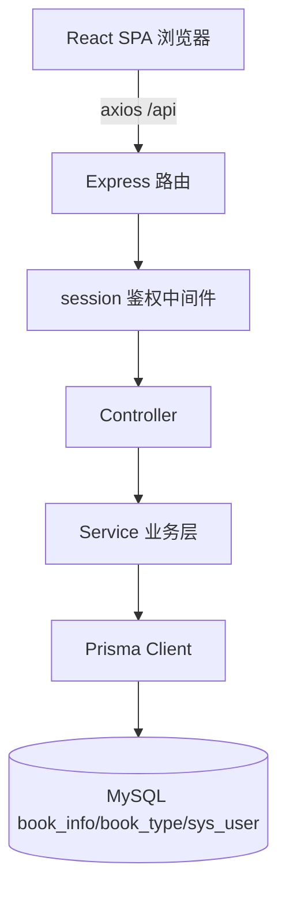

# 图书管理系统(TypeScript 前后端分离 · MVP 迭代)实施计划

## 一、产品概述

基于 TypeScript 的「图书借阅系统(后台)」前后端分离 Web 应用,功能对齐 2016 年 Java 毕业考试试卷-2,并叠加 quiz07.md 规定的 Git/GitHub 协作与 CI 流程。后端提供 REST API,前端为单页管理后台。

**开发策略:MVP 迭代**。先以最小可用产品跑通端到端核心链路(登录 → 列表 → 查询 → 详情 → 新增 → 修改 → 删除),再按迭代补齐测试、CI、抽象层与交付物。项目结构遵循「健壮、清晰、条目适中」:顶层按职责分包,后端按业务域内聚,**不提前创建前期用不到的文件**。

## 二、MVP 迭代规划

| 迭代 | 目标 | 交付内容 |
| --- | --- | --- |
| **迭代 1(本次 MVP)** | 跑通端到端核心链路 | 工程骨架、Prisma 模型与种子、后端 API、React 5 个页面与核心交互 |
| 迭代 2 | 质量与自动化 | Vitest + Supertest 用例、`.github/workflows/ci.yml`、GitHub Issues/PR 流程落地 |
| 迭代 3 | 增强与交付 | zod 校验抽离、公共 types 抽离、`db/init.sql` 导出、README 完善、UI 打磨 |


## 三、核心功能(迭代 1 必须)

- **登录**:账号密码登录(初始 admin/123456),登录态写入会话;新增图书「入库人」默认取当前登录用户。
- **图书列表(首页)**:默认显示全部入库图书,按入库时间降序;日期以「年-月-日」显示;列表隔行变色;分页展示,每页 5 条;每行含「查看/修改/删除」;顶部按图书名称模糊查询并记忆条件;提供「新增」按钮。
- **查询**:按图书名称模糊匹配,结果同按入库时间降序;返回后保留查询条件与页码。
- **明细查看**:只读详情页,展示图书编号、名称、类型、作者、出版社、是否借阅、入库人、入库时间;「返回」回到列表且保留查询条件与结果。
- **新增**:必填=图书编号、名称、类型(取自图书类型表:小说/文学/传记/艺术/少儿/经济/管理/科技)、是否借阅(默认未借阅)、入库人(默认当前用户)、入库时间(默认当前时间);成功或失败均提示,保存后回列表。
- **修改**:字段必填,但「入库人」「入库时间」只读不可改;成功或失败均提示,确定后回列表。
- **删除**:点击「删除」弹出「确定删除该图书信息?」确认,确认后删除并提示「删除成功/删除失败」。

## 四、技术选型

- 语言:TypeScript(前后端统一)
- 后端:Express + express-session(登录态)+ bcryptjs(密码哈希);zod 校验在迭代 3 引入
- 数据层:Prisma ORM(provider=mysql)+ MySQL 8,Prisma Migrate 管理表结构,Seed 脚本灌入测试数据
- 前端:React 18 + Vite + TypeScript + react-router-dom + Tailwind CSS + shadcn/ui;请求用 axios 封装,登录态依赖会话 Cookie
- 测试:Vitest + Supertest(迭代 2 引入)
- CI:GitHub Actions(Node + MySQL service 容器)(迭代 2 引入)
- 版本管理:Git + GitHub(Issues / PR / 合并删分支)
- 开发模式:后端 3001、前端 5173 双端口,Vite 代理 `/api`;生产由 Express 托管前端构建产物并回退 `index.html`

## 五、项目结构(迭代 1 MVP 实际创建)

设计原则:

1. **顶层按职责分包**:仅 `server/`(后端)、`client/`(前端)与根配置,层级浅、一眼可辨。
2. **后端按业务域内聚**:`auth` / `book` 两个域,域内自带 routes / controller / service,不做 CRUD 级拆分。
3. **前端按类型分层**:api / components / pages,职责单一、命名直观。
4. **不提前建文件**:公共抽象(config、types、validator、routes 汇总)按需在后续迭代补。

```
图书管理系统(整合github)/
├── server/                                  # 后端(Express + Prisma)
│   ├── prisma/
│   │   ├── schema.prisma                    # [MVP] book_info / book_type / sys_user 模型
│   │   └── seed.ts                          # [MVP] 测试数据(每表≥5,类型含 8 类)
│   ├── src/
│   │   ├── main.ts                          # [MVP] 启动入口
│   │   ├── app.ts                           # [MVP] 装配:会话 + 各域路由挂载 + 错误处理
│   │   ├── lib/prisma.ts                    # [MVP] Prisma Client 单例
│   │   ├── middlewares/auth.ts              # [MVP] 登录态校验中间件
│   │   └── modules/                         # 业务域内聚
│   │       ├── auth/
│   │       │   ├── auth.routes.ts           # [MVP] /api/auth(login/logout/me)
│   │       │   ├── auth.controller.ts       # [MVP]
│   │       │   └── auth.service.ts          # [MVP] bcrypt 校验
│   │       └── book/
│   │           ├── book.routes.ts           # [MVP] /api/books + /api/book-types
│   │           ├── book.controller.ts       # [MVP] 列表/详情/增改删 + 类型列表
│   │           └── book.service.ts          # [MVP] 分页/排序/默认值/只读规则
│   ├── package.json                         # [MVP]
│   └── tsconfig.json                        # [MVP]
│
├── client/                                  # 前端(React + Vite + TS)
│   ├── src/
│   │   ├── main.tsx                         # [MVP] 入口
│   │   ├── App.tsx                          # [MVP] 路由与全局布局
│   │   ├── api/index.ts                     # [MVP] axios 实例 + auth/book 接口封装
│   │   ├── components/                      # [MVP] 仅必要复用件:Layout / Pagination / Toast
│   │   ├── pages/                           # [MVP] Login / BookList / BookDetail / BookAdd / BookEdit
│   │   └── styles/index.css                 # [MVP] Tailwind 入口与设计变量
│   ├── index.html                           # [MVP]
│   ├── vite.config.ts                       # [MVP] 代理 /api → 3001、allowedHosts
│   ├── tailwind.config.js / postcss.config.js  # [MVP]
│   ├── package.json                         # [MVP]
│   └── tsconfig.json / tsconfig.app.json    # [MVP]
│
├── .env.example                             # [MVP] DATABASE_URL / SESSION_SECRET / PORT 样例
├── .gitignore                               # [MVP]
└── README.md                                # [MVP] 最小运行说明(交付细节随迭代完善)
```

## 六、MVP 阶段暂不创建的文件及原因

> 说明:这些文件并非取消,而是**推迟到对应迭代按需引入**,以避免过早抽象和重复维护。

| 暂不创建 | 原因 | 计划引入 |
| --- | --- | --- |
| `server/src/config/env.ts` | 前期环境变量仅 DATABASE_URL/PORT/SESSION_SECRET 寥寥数个,直接 `dotenv` + `process.env` 足够;提前建配置层是过度抽象 | 变量增多或需启动校验时(迭代 3) |
| `server/src/types/index.ts` | Prisma 已生成实体类型,少量 DTO 在使用处就近定义即可;过早建全局类型文件易沦为"杂物间"、增加无谓跳转 | 跨模块共享类型变多时(迭代 3) |
| `server/src/modules/bookType/*`(独立 3 文件) | book_type 本 MVP 只有"取全部类型供下拉"一个只读接口,独立成域属过度拆分;并入 book 域一个方法更清晰 | 需要图书类型 CRUD 时 |
| `server/src/routes/index.ts`(路由汇总) | 路由总量少,直接在 `app.ts` 挂载各域 router,少一层不必要的间接 | 路由模块增多时 |
| `server/src/modules/book/book.validator.ts` | 前期校验规则简单,基础必填校验内联即可;独立 zod 文件是增强项 | 校验规则复杂时(迭代 3) |
| `server/src/middlewares/error.ts`(独立文件) | MVP 的错误处理很少,直接写在 `app.ts` 的兜底中间件里;规则复杂后再抽独立文件 | 错误类型分化时(迭代 3) |
| `db/init.sql` | 表结构由 Prisma Migrate 管理,提前手写 SQL 会与 `schema.prisma` 双份维护、易不一致 | 交付/归档时从 schema 导出(迭代 3) |
| `server/tests/*.test.ts` | 流程资产,先保证核心链路可用再补回归,避免前期频繁改测试打断开发 | 迭代 2 |
| `.github/workflows/ci.yml` | 同上,CI 应在功能稳定后接入,减少管道反复调整 | 迭代 2 |
| `client/src/types/index.ts` | 前端类型少,可放在 `api/index.ts` 内就近导出 | 类型增多时(迭代 3) |
| `client/src/components/` 大部分组件 | 前期页面数量少,组件先内联在页面;出现复用再抽取,避免"为组件而组件" | 出现复用需求时 |


## 七、实现方案

前后端分离分层架构,后端 `route → controller → service → prisma`,业务规则集中在 service:

1. **后端 API**:`/api/auth`(login/logout/me)、`/api/books`(GET 分页+名称模糊查询、GET /:id、POST、PUT /:id、DELETE /:id)、`/api/book-types`(类型下拉)。分页与排序用 Prisma `skip/take` + `orderBy: { creationTime: 'desc' }`,列表数据与总数用 `$transaction` 并行查询;每页 5 条。
2. **查询条件记忆**:前端将 bookName、page 写入 URL query,详情返回时回传,天然保留条件与结果。
3. **只读字段防绕过**:修改接口在服务端忽略 createdBy、creationTime 的更新,仅允许只读展示。
4. **日期格式化**:服务端返回 ISO 时间,前端统一格式化为「年-月-日」。
5. **安全与可靠**:密码 bcrypt 哈希;session 保护后台 API;`app.ts` 兜底错误中间件返回结构化错误与可读消息;连接信息与 session 密钥用 `.env` 管理。
6. **避免技术债**:复用 Prisma + Express + Vite 主流约定,结构按「业务域内聚 + 前后端分层」组织,便于新增实体与同行评审。

## 八、架构设计



## 九、页面规划(共 5 页)

1. 登录页:居中登录卡片(系统标题、图标、账号、密码、登录按钮、错误提示、渐变背景)。
2. 图书列表页(首页):顶部导航(系统名+当前用户+登出)、查询工具条(名称输入框+查询/重置)、新增按钮、图书表格(编号/名称/类型/作者/出版社/是否借阅/入库时间/操作)、底部分页器与结果提示。
3. 图书详情页:只读信息卡片,字段纵向排列,底部「返回」按钮(携带查询条件与页码)。
4. 新增图书页:表单卡片(图书编号、名称、类型下拉、作者、出版社、出版日期、是否借阅单选)、入库人/入库时间默认值(只读展示),底部「保存/返回」,必填校验与提交提示。
5. 修改图书页:与新增页一致,但入库人/入库时间显式只读置灰。

交互要点:查询条件写入 URL 并回填;查看返回保留条件与结果;新增/修改成功失败提示后回列表;删除前确认弹窗,完成后提示成功/失败;列表与表单均有空态与加载态。

## 十、视觉风格

现代企业级后台:浅灰渐变背景承载白色玻璃质感卡片;主色沉稳蓝,表头深色、正文隔行变色;按钮圆角,主操作蓝色、删除危险红;输入框聚焦蓝色描边;成功/失败提示用顶部条幅或气泡区分绿/红;悬停有轻微阴影与过渡动画。字体 Noto Sans / PingFang SC,标题 22px/600、正文 14px/400。图标用内联 SVG(lucide-react),无外部图片依赖。

## 十一、测试与 CI(迭代 2)

- **单元/接口测试**:Vitest + Supertest 覆盖 auth(登录成功/失败、未登录拦截)与 book(分页、模糊查询、详情、新增、修改只读字段、删除)接口。
- **CI**:`.github/workflows/ci.yml` 使用 MySQL service 容器,执行 `prisma migrate deploy` + `seed` 后跑 `vitest run`,失败即阻断。

## 十二、GitHub 协作流程(按 quiz07.md)

1. 初始化仓库并在 GitHub 托管。
2. 创建两个 Issue:前端 Issue、后端 Issue。
3. 按 Issue 建分支开发,完成后提交 PR。
4. PR 通过 CI 回归后合并,合并后删除分支。

## 十三、Agent Extensions

### Skill

- **dev-expert**:主导 TypeScript + Express + Prisma + React 项目的代码实现、数据模型设计、分层架构与测试编写,保证代码规范与最佳实践。
- **agent-browser**:本地联调阶段打开页面截图,验证登录、列表分页与隔行变色、查询记忆、详情返回保留条件、新增/修改/删除提示等界面行为,确认 UI 符合 PDF 图-1 至图-9 预期。
- **playwright-cli**:对关键业务流程(登录→列表→查询→详情→新增→修改→删除)做端到端自动化回归验证,补充人工截图盲区。