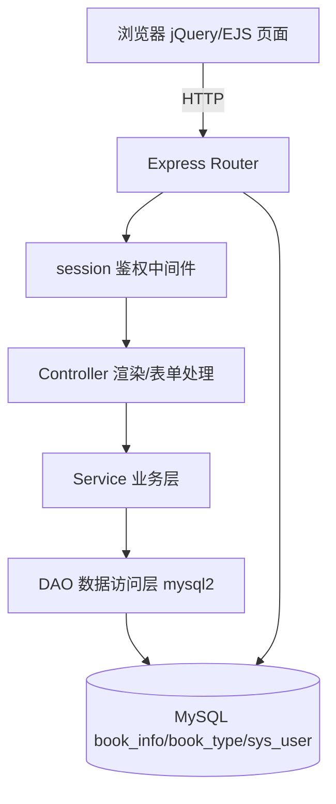

## Product Overview

一个基于 TypeScript 实现的「图书借阅系统(后台)」Web 应用,功能对齐 2016 年 Java 毕业考试试卷-2 的题目要求,并叠加 quiz07.md 规定的 Git/GitHub 协作与 CI 流程。系统为后台管理端,提供图书信息的查看、模糊查询、明细查看、新增、修改、删除,并扩展一个简易登录。

## Core Features

- **登录**:后台入口提供账号密码登录(初始账号 admin/123456),登录后将当前用户写入会话,用于默认"入库人"。
- **图书列表(首页)**:默认展示全部入库图书,按入库时间降序;日期以"年-月-日"显示;列表隔行变色;分页展示,每页 5 条;每行提供"查看/修改/删除"入口;顶部提供按图书名称的模糊查询框并记忆查询条件;提供"新增"按钮。
- **查询**:按图书名称模糊匹配,结果同样按入库时间降序;返回后保留查询条件与结果。
- **明细查看**:点击"查看"进入只读详情页,展示图书编号、名称、类型、作者、出版社、是否借阅、入库人、入库时间;点击"返回"回到列表且保留查询条件与结果。
- **新增**:必填项含图书编号、名称、类型(取自图书类型表:小说/文学/传记/艺术/少儿/经济/管理/科技)、是否借阅(默认未借阅)、入库人(默认当前登录用户)、入库时间(默认当前系统时间);提交成功或失败均给出提示,保存后回到列表页。
- **修改**:字段必填,但"入库人""入库时间"只读不可改;提交成功或失败均给出提示,确定后回到列表页。
- **删除**:点击"删除"弹出"确定删除该图书信息?"确认框,确认后删除,回到列表页并提示"删除成功/删除失败"。
- **视觉**:界面整洁美观、控件规整,列表隔行变色,表单提供必填校验与操作结果提示。

## Tech Stack Selection

- 语言:TypeScript(前后端统一)
- Web 框架:Express(Node.js),服务端渲染 EJS 模板
- 前端:原生 HTML + CSS + jQuery(CDN 引入),页面脚本用 TS 编写并编译为浏览器 JS
- 数据库:MySQL 8,访问层用 `mysql2/promise` 手写 SQL(不使用 ORM)
- 会话:express-session(简易登录)
- 校验与工具:密码哈希用 bcryptjs;环境变量用 dotenv
- 测试:Vitest + Supertest(仅后端接口与单元测试)
- 构建/运行:开发用 tsx,构建用 tsc(后端)+ tsc(前端独立 tsconfig)
- CI:GitHub Actions(Node + MySQL service 容器)执行回归测试
- 版本管理:Git + GitHub(Issues / PR / 分支删除)

## Implementation Approach

采用经典分层架构(Controller → Service → DAO → MySQL),与 PDF 中 Java 三层的思路一一对应,但用 TS 落地:

- **后端**:`mysql2/promise` 创建连接池;DAO 层封装参数化 SQL(防注入);Service 层承载业务规则(分页、排序、默认值、类型校验);Controller/Route 层负责 SSR 页面渲染与表单提交处理,并统一异常处理与消息提示。
- **前端资源**:所有 `.ts` 页面脚本编译到 `public/js`,浏览器加载编译产物;样式用纯 CSS;图标用内联 SVG(文本,无需外部图片素材);jQuery 走 CDN。页面图片默认不需要手工制作,如确需插图则用 AI 生图生成放入 `public/images`。
- **关键决策**:

1. 选 SSR + jQuery 而非 SPA,最贴近 quiz07.md"前后端 Express"与 PDF 的 jQuery 场景,且 CI 只需跑后端接口测试,成本最低。
2. 选 mysql2 手写 SQL 而非 ORM,贴近 PDF 的 Hibernate/MyBatis 思路,依赖更少、可控性更强。
3. 分页与排序在 SQL 层用 `LIMIT/OFFSET` + `ORDER BY creation_time DESC` 完成,避免全量加载;列表默认每页 5 条。列表查询与计数分两条 SQL,复杂度 O(logN) 索引扫描。
4. 查询条件记忆通过 URL query(?bookName=&page=)在服务端回填并在列表/详情返回时携带;模糊查询用参数化 `LIKE CONCAT('%',?,'%')`。
5. "入库人/入库时间"在修改页由服务端渲染为只读,并在服务端忽略这两字段的更新,防止绕过。

- **可靠性与安全**:所有 SQL 参数化;数据库操作统一 try/catch 并映射为用户可读提示;登录密码 bcrypt 哈希存储;session 保护后台路由;`.env` 管理数据库连接,不入库。
- **avoiding technical debt**:复用 Express/EJS/mysql2 的主流约定,目录按 config/types/dao/service/controller/middleware 分层,便于扩展新实体。

## Architecture Design



## Directory Structure

本项目为全新工程,在现有工作区根目录下创建以下文件与目录:

```
图书管理系统(整合github)/
├── src/
│   ├── app.ts                # [NEW] Express 应用装配(app、ejs、session、静态资源、路由、错误处理)
│   ├── server.ts             # [NEW] 启动入口,读取端口并监听
│   ├── config/db.ts          # [NEW] mysql2/promise 连接池,读取 .env
│   ├── types/index.ts        # [NEW] BookInfo/BookType/User/分页结果等类型定义
│   ├── dao/bookDao.ts        # [NEW] 图书分页查询/模糊查询/按ID查询/新增/更新/删除(参数化 SQL)
│   ├── dao/bookTypeDao.ts    # [NEW] 图书类型列表查询
│   ├── dao/userDao.ts        # [NEW] 按用户名查询系统用户
│   ├── service/bookService.ts# [NEW] 图书业务:分页、排序、默认值、类型存在性校验、日期格式化
│   ├── service/authService.ts# [NEW] 登录校验(bcrypt 比对)
│   ├── controller/bookController.ts # [NEW] 列表/详情/新增/修改/删除的渲染与提交处理、消息提示
│   ├── controller/authController.ts # [NEW] 登录/登出
│   ├── routes/index.ts       # [NEW] 路由注册与页面映射
│   └── middleware/{auth.ts,errorHandler.ts} # [NEW] 鉴权与统一异常处理
├── views/
│   ├── partials/head.ejs, header.ejs, footer.ejs # [NEW] 公共布局、导航、页脚(内联 SVG 图标)
│   ├── login.ejs             # [NEW] 登录页
│   ├── bookList.ejs          # [NEW] 列表页(分页、隔行变色、查询框记忆、查看/修改/删除)
│   ├── bookDetail.ejs        # [NEW] 只读详情页(含返回)
│   ├── bookAdd.ejs           # [NEW] 新增页(默认值、必填校验、JS 提示)
│   └── bookEdit.ejs          # [NEW] 修改页(入库人/入库时间只读)
├── public/
│   ├── css/style.css         # [NEW] 全局样式(卡片、表格隔行变色、按钮、响应式)
│   ├── js/                   # [NEW] 前端 TS 编译产物(bookList.js/bookForm.js/login.js)
│   └── images/               # [NEW] 可选插图(AI 生成,非必需)
├── frontend/src/             # [NEW] 前端 TS 源码(bookList.ts/bookForm.ts/login.ts),独立 tsconfig 编译到 public/js
├── db/init.sql               # [NEW] 建库建表(book_info/book_type/sys_user)、主键自增、测试数据(每表≥5,book_type 含 8 类)
├── tests/                    # [NEW] Vitest 用例:book.test.ts/auth.test.ts(Supertest 走接口)
├── .github/workflows/ci.yml  # [NEW] CI:装依赖、启动 MySQL service、初始化 SQL、跑 vitest
├── package.json / tsconfig.json / tsconfig.frontend.json / vitest.config.ts # [NEW] 工程与构建配置
├── .env.example / .gitignore # [NEW] 环境变量样例与忽略规则
└── README.md                 # [NEW] 运行说明、数据库说明、GitHub 协作与 CI 说明
```

## 设计定位

后台管理系统,采用简洁的现代企业级管理界面风格(浅色底、蓝色主色、卡片化布局),重点突出表格数据与表单操作的可读性与规整度。基于 Express + EJS 服务端渲染 + jQuery,布局使用 Flex/Grid,图标使用内联 SVG,无外部图片依赖。

## 视觉风格

浅灰背景承载白色卡片;主色为沉稳蓝;表格表头深色、正文隔行变色(#F7F9FC);按钮圆角、主操作蓝色、删除危险红;输入框聚焦有蓝色描边;表单错误/成功提示用顶部条幅或气泡,配色区分成功(绿)/失败(红)。悬停有轻微阴影与过渡动画,整体清爽、克制、专业。

## 页面规划(共 5 页)

1. 登录页:居中登录卡片(标题、图标、账号、密码、登录按钮、错误提示)。
2. 图书列表页(首页):顶部导航(系统名+当前用户+登出)、查询工具条(图书名称输入框+查询/重置)、新增按钮、图书表格(编号/名称/类型/作者/出版社/是否借阅/入库时间/操作)、底部分页器与结果提示。
3. 图书详情页:只读信息卡片,字段纵向排列,底部"返回"按钮(携带查询条件与页码)。
4. 新增图书页:表单卡片(图书编号、名称、类型下拉、作者、出版社、出版日期、是否借阅单选)、入库人/入库时间默认值(只读展示),底部"保存/返回",jQuery 必填校验与提交提示。
5. 修改图书页:与新增页一致,但入库人/入库时间显式为只读置灰。

## 各页关键区块(自上而下)

- 公共:顶部导航栏(品牌+用户菜单)、内容容器卡片、底部页脚。列表页额外含查询区、表格区、分页区;表单页额外含表单区、按钮区。
- 交互:查询框回填并记忆条件;查看返回保留条件与结果;新增/修改成功失败弹提示后回列表;删除前 confirm 确认,完成后提示成功/失败。

## Agent Extensions

### Skill

- **dev-expert**
- Purpose: 作为全栈编程专家主导 TypeScript + Express + MySQL 项目的代码实现、SQL 设计、分层架构与测试编写,保证代码规范与最佳实践。
- Expected outcome: 产出可运行的分层后端、EJS 页面、参数化 SQL 与测试用例,符合工程纪律与代码规范。
- **agent-browser**
- Purpose: 在本地联调阶段打开页面截图,验证列表分页、隔行变色、查询记忆、详情返回保留条件、新增/修改/删除提示等界面行为。
- Expected outcome: 输出各页面的可视化截图与交互结果,确认 UI 与流程符合 PDF 图-1 至图-9 的预期。